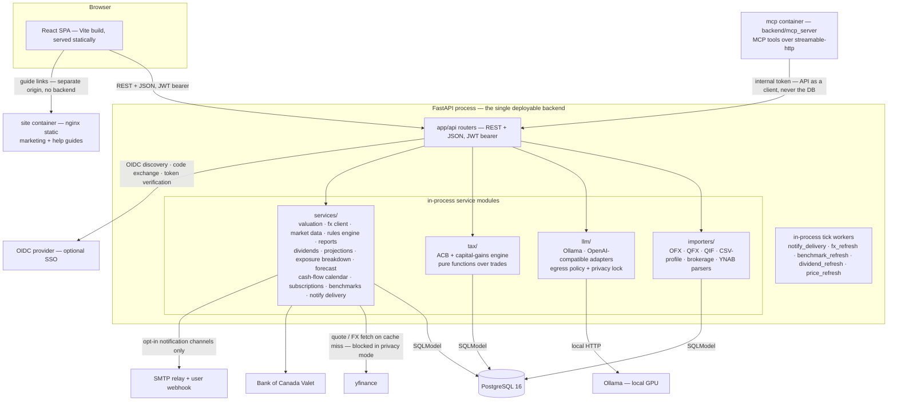
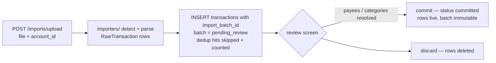
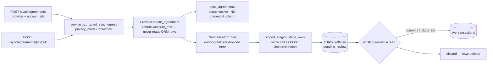
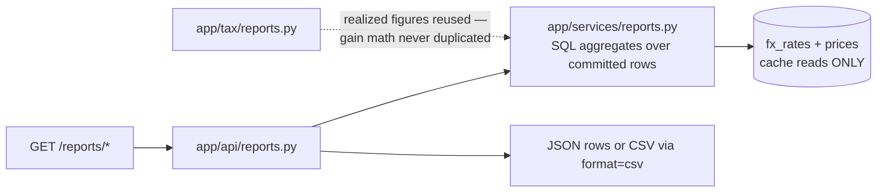

# 01 — Architecture

## Service diagram

One FastAPI application is the **only backend that touches the database**; the SPA talks to
that API over REST. Importers, the categorization pipeline, and market-data access are
**internal service modules inside that FastAPI process**, not microservices. Two sidecar
processes sit beside it and are drawn below: the **MCP agent server** (docs/23 — its own
container, it reaches the API over HTTP with a shared internal secret, never the DB directly)
and the **static marketing/guides site** (docs/32 — no backend, no DB).



Data model and ERD: docs/02. Background work runs three ways, all in-process
(v1): FastAPI `BackgroundTasks`, the five tick workers started in `main.lifespan`
(notification delivery, FX rate-book refresh, benchmark-series refresh,
tenant-scoped dividend-history refresh, and the scheduled price refresh (M187,
docs/07 §Scheduled price refresh) — each has an enable flag tests can force off), and the
fingerprint-triggered autoheal cron that lives outside the stack (§Health check & rate
limiting). Nothing in the schema assumes a dedicated worker process, and no job queue is required.

## Request lifecycle

Token mechanics (payload shapes in docs/08): access JWT TTL **15 min**, signed **RS256** with the `access` key and a `kid` header (t_d3176af6, docs/38 §Key separation); refresh token is 32 random bytes stored only as a SHA-256 hash in `refresh_tokens` (docs/02), TTL **30 days**, rotated on every refresh; replaying an already-revoked refresh token revokes ALL of the user's sessions (reuse detection, security-hardening). The 2FA-challenge and OIDC-hand-off JWTs are signed **RS256** with a separate `session` key, so an access-key leak cannot forge a long-lived session. Password hashing: `bcrypt`, cost >= 12, in `core/security.py`.

```mermaid
sequenceDiagram
    autonumber
    participant UI as React SPA
    participant API as FastAPI
    participant DB as PostgreSQL

    UI->>API: POST /auth/register or /auth/login
    API->>DB: bcrypt verify + INSERT refresh_tokens (hash only)
    API-->>UI: user + access_token (15 min); refresh_token (30 d) as httpOnly cookie only — never in the body (audit M1)

    UI->>API: any /api/v1 call with Authorization Bearer header

    Note over UI,API: access expired -> 401
    UI->>API: POST /auth/refresh (presented refresh token)
    API->>DB: revoke presented row + issue successor (rotation, docs/02)
    API-->>UI: NEW token pair
    UI->>API: replay the original request ONCE
    Note over UI: another 401 redirects to /login<br>POST /auth/logout revokes the presented refresh token
```

CORS: dev allows `http://localhost:5173` via `CORS_ORIGINS` (pydantic-settings); the Vite dev server proxies `/api` → `http://localhost:8000`, so dev and prod share one origin shape.

### Sessions and the event loop (M148, M149)

**Rule: the event loop never waits on the database, and it never does blocking work of its own. A `Session` is never held across an unbounded wait.**

The container runs ONE uvicorn worker. Sync handlers run in anyio's worker threads, but every `async def` — dependencies included — runs on the event loop, and a SQLAlchemy pool checkout **blocks** (`pool_timeout`, 30 s by default). A blocking DB call in async code therefore freezes *every* request in the process, including the handlers that already hold the connections being waited for. The waiters can never be served, because the loop that would free the pool is the loop they just froze: a self-deadlock that only a container restart clears.

This is not theoretical. 2026-10-11 03:08 UTC a burst of `GET /forecast/run` checked out the whole pool (5 + 10); every request that then queued for a connection froze the loop for the full 30 s timeout, so the in-flight handlers could never finish and never closed their sessions. 15 sessions sat `idle in transaction`, `/health` answered nothing, and the API stayed down for every user until `docker restart`. The forecast route itself was innocent — pure compute, no I/O.

How the rule is held:

- **`get_db` stays a SYNC generator dependency.** FastAPI resolves and closes sync generator dependencies in a worker thread, so the session is opened *and* released off-loop. Making it `async def` moves both onto the loop.
- **`get_current_user` / `get_current_user_with_query_token` are `async def` on purpose** (their ContextVar privacy-lock binds must land in the request's own task, docs/11 step 6) — so their one query goes through `run_in_threadpool`. Same for any new async route or dependency that touches the DB.
- **An `async def` route that needs `await file.read()` hops the REST of its body (M149).** `async` is required only for the read; everything after it is ordinary blocking Python — CSV parse, a per-row duplicate query, an LLM call of up to 60 s, a 2 MB base64 round-trip. Six upload/parse routes do it that way, all through ONE helper, `app/api/_offloop.py::blocking`: a nested sync `core()` holding the blocking half, then `return await blocking(core)()`. The three assistant transition routes (`POST /assistant/proposals/{id}/apply|dismiss|undo`, t_cf8fc13f) hop their ENTIRE body through the same helper — they need no `await` at all, but the proposal-row `FOR UPDATE` wait must never run on the loop: it did until the security review, and a held row then froze every request in the process, `/health` included (docs/57 §4). `POST /assistant/ask` hops its WHOLE turn the same way (t_828c243a, security F4) — it needs no `await` either, and its provider send is a synchronous `httpx.post(timeout=60)`, so run on the loop it froze the entire API behind one ask for up to a minute: any registered user may set `llm_base_url` to an endpoint of their choosing, and an 8.1 s ask was enough to make `/health` time out (pinned by `tests/test_assistant_ask_offloop.py`). An early DB guard hops on its own — `await blocking(owned_or_404)(...)` — so a 404 still lands before the body is read. The request's session is used inside the hop **sequentially, never concurrently**, which is the same contract `get_current_user`'s hop already relies on. `blocking()` refuses a coroutine function, because wrapping one would silently return an un-awaited coroutine instead of running anything.
- **Every egress client is bounded**: fx 10 s, market data 5 s, LLM 60 s, OIDC 10 s, SMTP 10 s, rules-engine regex 0.1 s. A session is never held across an unbounded network call. "Market data" is ours, not yfinance's: `services/market_data.py::_yf_session` re-types yfinance's own default session into a subclass that forces `timeout=5` on `Session.request` — the one method every yfinance call, cookie handshake included, ends in — and installs it on yfinance's process-wide `YfData` singleton, which is the ONE session the library re-uses for every ticker (docs/07).
- `tests/test_m148_pool_deadlock.py` pins it against the real ASGI stack: hold every connection of a two-connection pool, make an authenticated request, and assert an unrelated request is still served inside 1 s (it fails at ~2 s — the whole pool timeout — without the threadpool hop).
- `tests/test_m149_offloop_routes.py` pins the route hop the same way: make one upload/parse route block for 2 s on purpose and assert an unrelated request is still served inside 0.5 s (2.02 s without the hop) — one route per affected router, plus a tripwire over all six. `tests/test_m149_yf_timeout.py` pins that the market-data deadline reaches the transport and overrides yfinance's own 30 s default.
- **The rule is not only about the loop — it is about holding a `Session` at all.** A tool that waits on the network with a transaction open produces the same `idle in transaction` row an incident does, which is exactly how a *healthy* operator run read as a prod leak (M152). `scripts/backfill_etf_holdings.py` runs for minutes — one provider fetch per fund, plus `--sleep` — and used to keep the session that ran its candidate SELECT open for the whole run; the candidate query and the per-fund row count each get a session of their own now, closed before the next fetch. `tests/test_m152_seed_session.py` asks the question from INSIDE the provider call: no session the script opened may still be in a transaction, and no backend may be `idle in transaction` on that statement (both red without the fix).
- **The background enrichment task is held to the same rule (M153).** `_run_enrichment` (`services/fund_enrichment.py`) is the *serving* half of that class: `api/imports.py` and `api/trades.py` both queue it as a FastAPI `BackgroundTask`, it opens its own session out of `deps.get_engine()` — the API's pool — and it used to hold a transaction across the whole provider chain: `session.get` autobegins, and the very next act of `import_fund_composition` is a network fetch. `ensure_sub_fund_composition` was the worse half (one transaction across up to 12 sub-funds' worth of lookup → import → fundamentals → price backfill), and `ensure_fundamentals` carried the same shape on its own (SELECT, then `fetch_fundamentals`). The fix is one seam, `services/market_data.py::release_before_provider_wait`: it commits the read transaction back to the pool right before each wait, loads the ORM attributes the provider call is about to read *inside* the transaction being released (so the release is the last database contact before the wait, not the lazy load that follows it), and pins `expire_on_commit` off for the duration of the commit — a plain `commit()` would expire every loaded object, and the next attribute access would silently re-open the transaction the release just gave back, which is exactly what a default-configured session does (that failure is pinned, index 2 of the probe trace). `ensure_sub_fund_composition` owns the transaction it runs in and both of its callers are background tasks with their own session (`fund_enrichment._run_enrichment`, `api/securities._run_deepen`) — there is no request session to commit early or roll back. `tests/test_m153_enrichment_session.py` asks it from INSIDE every provider seam on the path — the fund's import, the deepening loop's lookup/import/fundamentals/backfill for two sub-funds, and the task's own fundamentals refresh: no session the task opened may be in a transaction, and no backend may be `idle in transaction` (both red without the fix).
- **The price paths are held to the same rule, request sessions included (M155/M161).** `backfill_range` (`fetch_history` first) and `ensure_recent_price` (`newest_price` SELECT, then `fetch_latest_close`) were the two seams M153 deliberately left alone, and they are reached by BOTH background tasks (`api/securities._run_backfill`, `api/portfolio._run_ensure_recent_price` — the market-hours fan-out) and REQUEST sessions (`GET /securities/{id}/overview`, `POST /securities/{id}/refresh`, and `valuation.compute_positions`, the `/portfolio/positions` read path that calls `ensure_recent_price` once per held security). A request session's connection is checked out for the whole request either way, so the release changes what it holds during the wait from `idle in transaction` — the row vacuum waits on — to `idle`, and hands the connection back to the pool for the duration of the fetch. The seam is placed per caller (docs/07 §Price-path sessions has the table): inside `ensure_recent_price`, because it does its own SELECT immediately before the wait and the positions loop would otherwise reopen the transaction once per held security; at the two `backfill_range` callers, because `services/symbol_repair.repair_symbol` reaches that fetch with flushed, uncommitted writes and a dry-run contract that depends on `session.rollback()` — a release inside the function would commit an operator's read-only `repair_symbol` run. That is the rule in one line: **release a session that has nothing pending, and let the caller that does keep its transaction.** `tests/test_m155_price_session.py` asks both questions from inside every provider seam on these paths, and pins what the release costs (two commits per held security that actually fetched, zero when the close is already dated today) as well as the repair caller's exception.
- **The class is closed by ENUMERATION now, not by report (M175).** Four waves each fixed the seam a report named; M175 listed every remaining path that reads and then waits, and released the ones that could be released: the deep-price sweep (`deep_backfill.backfill_security` — `scripts/deep_price_backfill.py` is a dry run by DEFAULT and walked every held row on ONE session), the benchmark sweep (`benchmarks.backfill_symbol`), the Valet fetch-on-miss (`fx.latest_rate`, reached once per foreign-listing position by `valuation.compute_positions`, and `fx.get_rates_between` on its `commit=True` side), the scheduled fx worker (`fx_refresh.run_once`), the split repair (`split_repair.repair_split_window`), the app's longest wait (`categorization._process_one_batch`, 60 s LLM egress retried once), the notification dispatcher (`notify_delivery._dispatch`, one SMTP/webhook wait per delivery in the batch, with the batch's writes uncommitted on the session) and seven request routes (`GET /securities/lookup`, `GET /securities/quote-check`, `POST /securities/{id}/holdings/import`, `GET /trades/dividend-suggestions`, `POST /sharing/invites`, and — found when the guard grew the LLM Protocol, t_4eb1fcbc — `POST /users/me/llm-test` and `POST /imports/suggest-profile`). The seam itself moved to `services/session_release.py::release_before_provider_wait` (re-exported as `market_data.release_before_provider_wait`) because the class is no longer only a market-data one. Three callers deliberately keep their transaction — `symbol_repair.repair_symbol`, `trades._resolve_security` (the staging import's flushed `import_batches` row) and `tax/acb.py`'s rate backfill inside the never-committing `rebuild_user_pools` — and each is pinned by a test. The whole ledger is docs/07 §Provider-wait ledger (M175), and `tests/test_provider_wait_ledger.py` is its executable form: it AST-walks `backend/app`, keys every network primitive, every provider-seam call and every dynamic Protocol dispatch (the four bank-sync methods plus the LLM Protocol's `chat`, matched on the METHOD so no receiver name can hide one) by its enclosing function, and fails when one is unclassified (or when a classification goes stale) — so a NEW member of this class cannot appear quietly. M188's `POST /assistant/ask` joined the same ledger as an in-function release (`services/assistant.py::ask` releases after its context reads and `build_provider`, then persists the proposal from locals — docs/07 §Provider-wait ledger row).

### Row-level security context (docs/55)

**Rule: the request path carries the tenant into the database, transaction-locally, and the database is the SECOND lock after the application's `user_id` filters.**

`get_db` opens sessions on the REQUEST engine (`deps.get_request_engine`): when `APP_DATABASE_URL` is configured that is the unprivileged `fintrack_app` role, which the table policies constrain; while it is unset (local dev, the test suite, mid-rollout) it is the maintenance engine and the policies are inert — `app.core.rls.log_rls_status` names that state at boot, and `verify_request_role` REFUSES to boot if the configured request role is a superuser, BYPASSRLS, or the schema owner (a connection RLS cannot constrain would serve while enforcing nothing).

The authenticated tenant is published by `get_current_user` / `get_current_user_with_query_token` (`app.core.rls.bind_request_tenant`) BEFORE the session's first query; an engine-level `begin` listener stamps it with `set_config('app.tenant_id', …, is_local=true)` on whichever connection the next transaction begins on. Transaction-local is the whole safety story: the value dies with the transaction, so a pooled connection can never carry one request's tenant into the next (pinned by `tests/test_rls_isolation.py::test_begin_stamp_is_transaction_local_and_dies_with_the_transaction`). The two flows that must write tenant rows BEFORE any identity exists — `POST /auth/register` (the user's ten default categories) and the demo seed — call `set_tenant_now`, which stamps the live transaction as well.

Background workers, post-response `BackgroundTasks`, scripts, operator psql and alembic keep using the maintenance engine (`deps.get_engine()`): they are system paths that legitimately cross tenants, and their queries keep their explicit `user_id` filters exactly as before. Full policy registry, helper functions, rollout and residual risks: docs/55.

## Health check & rate limiting

- **Health**: `backend/app/api/health.py` mounts `GET /api/v1/health` (DB liveness probe; `200` when healthy, `503` if the database is unreachable). It is the only router outside the standard resource set and carries no auth. It needs a pool connection like any other request, so a saturated pool makes it fail too — that is deliberate: it is the signal that users are not being served.
- **Autoheal (M148)**: docker's `restart: unless-stopped` never restarts a container that is RUNNING but answering nothing, so the compose healthcheck above is only half the story. `scripts/autoheal.sh` runs from the host every minute (cron on the deploy box), counts **consecutive** unhealthy rounds, and issues `docker restart` at three — one restart per three minutes of genuine unhealth, with any healthy round resetting the counter so a busy service is never bounced. Install line and reasoning are in the script header; it is deliberately a host cron rather than a compose sidecar, because a sidecar needs the docker socket mounted into a container.
- **API docs are authenticated by default (M87, docs/42)**: FastAPI's `/docs`, `/redoc` and `/openapi.json` are re-registered behind `Depends(require_docs_access)`, so a request without a session access token or a live MCP token gets `401 {detail, code}`. `API_DOCS_PUBLIC=true` (the `.env.example` dev value) opens them; unset/false in production fails closed. `app.openapi()` itself still builds the schema.
- **Rate limiting** (`backend/app/core/ratelimit.py`): a `slowapi` `Limiter` keyed on the trusted `X-Forwarded-For` hop (rightmost value). The chain is single-hop by construction: TLS terminates on the front proxy, which sets `X-Forwarded-For` to the real client; the web nginx rewrites `$remote_addr` from it **only** for that peer (`set_real_ip_from` naming the trusted proxy hop — an environment-specific address, deliberately not written down here — `real_ip_header X-Forwarded-For`, `real_ip_recursive on`) and then REPLACES the header with `proxy_set_header X-Forwarded-For $remote_addr`, so a client-supplied XFF is never forwarded and every public caller keys its own bucket. The one exception is `POST /assistant/proposals`: it also runs a bucket per **authenticated** tenant (`app.core.rls.tenant_ctx`, set only from a verified access or MCP policy token) and skips the per-client-IP ceiling when a request carries no hop at all — the MCP server calls the API from the platform's own container address, so an IP-only key there would be ONE bucket for every tenant on the instance (docs/59 §8, security F3-b, t_828c243a). Global enable is read live from the `RATE_LIMIT_ENABLED` setting (`settings.rate_limit_enabled`), flipped in `main.lifespan` so tests can opt in without a rebuild. `rate_limit_exceeded_handler` returns `429 {detail, code: "rate_limited"}`.
  - Auth limits: `POST /auth/register` **5/min**, `POST /auth/login` **10/min**, `POST /auth/demo` **5/min**, `POST /auth/refresh` & `POST /auth/logout` **30/min**.
  - Import limits (human-paced): `/imports/upload`, `/imports/suggest-profile`, `POST /trades/import` **6/min**; `/imports/{id}/commit|discard|revert` **10/min** (docs/03).
   - Other human-paced buckets (all defined once in `core/ratelimit.py`, each with its stated reason): `/sync/agreements`, `/{id}/pull`, `/{id}/revoke` **10/min** (docs/39 — every pull is an outbound provider call); `POST /sharing/invites` **5/min** and the sharing accept/cancel/scope/revoke mutations **10/min** (docs/43 §11 — the invite route is the token-spam avenue); `PUT|DELETE /transactions/{id}/receipt` **12/min** (M108 — a 2 MB replay amplifier); `POST /users/me/change-password`, `PATCH /users/me/profile`, `DELETE /users/me` **10/min** (docs/38 — each verifies the current password with a full bcrypt hash, so without a ceiling a stolen access token is an offline-speed oracle over it); `POST /fx` **10/min** (docs/07 — it is the only write path any tenant has into the shared `fx_rates` cache); `POST /assistant/ask` **12/min** (M188, docs/57 — twice the import-suggest ceiling because every ask is one model round trip); `POST /assistant/proposals` **12/min** (`ASSISTANT_PROPOSE_LIMIT`) and one shared **12/min** bucket across apply/dismiss/undo (`ASSISTANT_TRANSITION_LIMIT`, docs/57 §3b/§4) — both added by the security review (t_cf8fc13f): slowapi decorates per route, so the old claim that the propose route "inherits ask's posture" had nothing behind it (30/30 proposes → 201, zero 429), and the transitions now do their blocking work in worker threads, where a hammering client still needs a ceiling.
   - Second-factor routes are tight because they are guessable-by-design: `POST /auth/totp/setup|confirm|disable` **5/min**, and every login-step route — `/auth/login/totp`, `/auth/login/recovery`, `/auth/passkeys/login/options`, `/auth/passkeys/login` — **10/min** (docs/38).
   - OIDC SSO (off by default) keeps the same shape: `GET /auth/oidc/login` **5/min**, `GET /auth/oidc/callback` **10/min**, `POST /auth/oidc/confirm` **5/min** (docs/38).
  - Internal auth: `POST /auth/mcp-tokens` **10/min**; `POST /auth/validate-mcp-token`, `POST /auth/internal-issue-token` and `POST /auth/internal-mcp-audit` (M80) **120/min** each — all three also `deny all` at the public nginx (docs/08). The MCP transport itself is the one MCP path the proxy OPENS: `location /mcp/` strips that prefix and forwards to the mcp container via Docker DNS (a variable upstream + `resolver 127.0.0.11`, so a recreated container's new IP is picked up per request), so clients reach `https://<host>/mcp/mcp`; auth there is the bearer token (docs/23).
  - `GET /securities/lookup` (yfinance symbol lookup) **30/min**.
## Core flows

### Staged import (docs/03)



### Bank sync (docs/39)



No edge reaches `accounts.starting_balance`: a `NormalizedBalance` is reported
in the pull response and never persisted (manual data wins). File upload and
bank pull enter the diagram at the same node on purpose — that is what
"ingestion parity" means (docs/03).

### Report aggregation (docs/12)



Note there is deliberately NO edge from the report path to yfinance/BoC: report endpoints never trigger external fetches, so they behave identically under privacy mode (docs/12 principles, docs/11 lockdown).

## Stack (locked)

| Layer | Choice |
| --- | --- |
| Language | Python 3.12+ |
| API | FastAPI |
| ORM/models | SQLModel |
| Migrations | Alembic |
| Database | PostgreSQL 16 |
| Settings | Pydantic v2 (`pydantic-settings`, env/.env) |
| Money types | `Decimal` end-to-end via SQLModel `Numeric` columns |
| Background jobs | FastAPI `BackgroundTasks` (v1) + five in-process tick workers (`notify_delivery`, `fx_refresh`, `benchmark_refresh`, `dividend_refresh`, `price_refresh`) started in `main.lifespan`; no job queue, no dedicated worker process |
| Frontend | React + TypeScript + Vite, TanStack Query, Recharts, Tailwind |

If Next.js is preferred for the future hosted version, swap-out is documented here as the sanctioned alternative; everything behind the REST boundary is unaffected.

## Tooling & quality gates

| Concern | Choice |
| --- | --- |
| Python packaging | PEP 621 `backend/pyproject.toml`, locked with `uv` (`uv.lock` committed); Docker image runs `uv sync --frozen`. `[tool.uv] constraint-dependencies` floors every top-level dependency (runtime + dev) at the version the tree was gated against, so a `uv lock` re-resolution on two machines cannot drift below a tested version — bump floor and lock in the same change when upgrading |
| Lint/format | `ruff check` + `ruff format --check` (config in `pyproject.toml`). Lint rules: `E F I UP B S RUF` — `S` is the bandit set (hardcoded secrets, `assert` in non-test code, bare `except: pass`, insecure hashes, `shell=True`); `tests/**` ignores `S101/S105/S106` so tests keep plain `assert` and sample credentials; a justified inline `# noqa` marks each deliberate exception elsewhere (public demo password, JWT method claim, registry-derived SQL) |
| Backend tests | `pytest` + FastAPI `TestClient` against a REAL Postgres (compose `db` / CI service container) — never SQLite (Numeric and enum behavior differ). The suite runs **parallel** (`pytest-xdist`, `-n auto --dist loadfile` via `addopts` — one test file never straddles workers, and every worker is its own pid, so conftest's per-pid suite-DB naming isolates them without coordination; a pinned `TEST_DB_ID` gets a per-worker suffix, and child pytest runs that pin one pass `-n0 --no-cov`) and **reports coverage** (`pytest-cov`, `--cov=app --cov=mcp_server`) from the same gate command — **baseline recorded 2026-10-30: 93%** (22,230 statements, 1,629 missed; later regressions show up as this number dropping). `hypothesis` property tests pin money-rounding (`cents`), the dedup hash and the OFX importer — pure functions only, never the database |
| Frontend checks | `tsc --noEmit`, ESLint (typescript-eslint), `vitest run`, `vite build`; routing via `react-router-dom` |
| CI | `.github/workflows/ci.yml`: backend job (ruff + pytest with postgres:16 service), web job (tsc + eslint + vitest + build), `status` job (`if: always()` — writes a `## ! RED on origin/main` step-summary marker when any needed job fails; branch protection is unavailable on the free plan, M85); **all four jobs carry the `vars.CI_ENABLED` kill switch** (unset/false ⇒ every job `skipped`, run recorded and GREEN, no runner requested — see the `CI availability (2026-10-11)` row); least-privilege `permissions: contents: read`; secret scan fails on any tracked `.env`/`.env.*` except `.env.example`, plus `secret|pem` filename hits, plus (M85) a content scan of the pushed range's ADDED lines for `keyword = "…"` literals and `sk-`/`ghp_`/`AKIA` token shapes — its allowlist of documented test placeholders is a comment in the workflow; `.github/workflows/deploy-smoke.yml` (workflow_dispatch) re-runs that battery against the public origin after a deploy; every `uses:` is SHA-pinned with its release tag as a comment (M85) |
| CI availability (2026-10-11) | The CI workflow is **disabled at the repo level** — `state=disabled_manually`, flipped with `gh api -X PUT repos/margosmark/fin_tracker/actions/workflows/341669592/disable` — while Actions billing is dead on the account. Since 2026-10-11 every run reddened in 4-7 s with "The job was not started … recent account payments have failed": a billing annotation on all four jobs, not a test verdict, and with no branch protection on this plan (M85 item 2) that red was the only gate the repo has — a dead payment read exactly like a failing build. Disabled means a push creates NO run at all: nothing red, nothing billable, pushes keep landing. `deploy-smoke.yml` stays active (manual dispatch only — never fires on a push). **Re-enable the workflow now** — the guard makes it safe: `gh api -X PUT repos/margosmark/fin_tracker/actions/workflows/341669592/enable`. **Landed 2026-10-11: the in-tree `CI_ENABLED` kill switch.** Every `ci.yml` job carries `if: ${{ vars.CI_ENABLED == 'true' }}` (the `status` job adds `always() &&`), so the repository VARIABLE is the switch and the repo-level state above is only the outer hard off: unset or `false` ⇒ all four jobs `skipped`, the run is still RECORDED on every push (history stays continuous) and concludes GREEN with no runner requested, no billable minute and no billing annotation; `true` ⇒ CI runs normally. Control it with `gh variable set CI_ENABLED --body false` or `--body true` (visible in Settings → Actions → Variables); unset is deliberately OFF so a missing variable fails safe to skipped, never to red. It reached the tree through a write-enabled **deploy key** (`ssh` push) — an OAuth push of `.github/workflows/*` is refused without the `workflow` scope (this box holds only `gist, read:org, repo`). `deploy-smoke.yml` is deliberately NOT gated (see the comment in that file): a human dispatching it while billing is dead needs the red annotation, not an all-green run whose smoke battery never executed. **Set `CI_ENABLED=true` only after billing is genuinely fixed** (GitHub → Settings → Billing & plans) — flipping it while billing is dead recreates exactly the gate-shaped red this switch exists to kill. Outer hard off: `gh api -X PUT repos/margosmark/fin_tracker/actions/workflows/341669592/disable` |
| Dependency updates | `.github/dependabot.yml` (M85): weekly — `npm` in `/frontend`, `uv` in `/backend` — 5 open PRs per ecosystem; neither lockfile had a checker before |

## Repository layout

Monorepo; directories come into existence across milestones M1–M179 (see Build order). Every path below that other docs reference by name appears here exactly as referenced.

```text
fin_tracker/
├── .env.example                     # DATABASE_URL/POSTGRES_PASSWORD, JWT_SECRET/TTLs, COOKIE_SECURE, LLM_*, REPORTING_CURRENCY=CAD
├── .github/
│  ├── dependabot.yml                # weekly dependency PRs: npm in /frontend · uv in /backend · 5 open PRs each (M85 item 4)
│  └── workflows/
│     ├── ci.yml                     # backend job (ruff + pytest w/ postgres:16 service) · web job (tsc + eslint + build) · status job (RED step-summary marker) · permissions: contents:read · .env.* + content secret scan · ALL FOUR JOBS GATED on the `vars.CI_ENABLED` kill switch (unset or false = every job skipped, run recorded and GREEN, no runner) · repo-level disable is the outer hard off while Actions billing is dead (docs/01, "CI availability")
│     └── deploy-smoke.yml           # workflow_dispatch only: runs scripts/smoke.sh against the PUBLIC origin after a deploy (M85 item 3) · no secrets in the file · stays active (never fires on a push) · deliberately NOT gated by the CI_ENABLED kill switch — a manual dispatch must be able to show the red billing annotation
├── docker-compose.yml               # db · api · web · mcp · site — see §Docker-compose services
│
├── site/                            # static marketing + help-guide site, no backend/DB (docs/32)
│  ├── index.html · changelog.html   # landing + release notes
│  ├── guides/                       # one HTML guide per topic (imports, brokerage, YNAB, agent integration, configuration …)
│  ├── assets/ · styles.css
│  └── Dockerfile                    # nginx-unprivileged, listens on 8080 in-container (L22: non-root)
├── mcp_uploads/                     # host bind target for the mcp container's file_path upload jail (compose) — NOT committed
├── local/                           # host-side scratch notes; never deployed
├── architecture.html · landing.html # static one-pagers committed at the repo root
│
├── scripts/
│  ├── autoheal.sh                   # host cron, every minute: three consecutive unhealthy rounds → `docker restart` (M148, §Health check & rate limiting)
│  ├── smoke.sh                      # live post-deploy battery: status-only output, mints+deletes its own throwaway account (delete runs from an EXIT trap, so a crash mid-battery does not leak it), token in-process (no secrets to configure); ssh target for steps 8-9 from `SMOKE_SSH_HOST` (default `example.internal` placeholder — the remote steps self-skip unless the operator supplies a host at run time, so no LAN/topology reference lives in the repo)
│  ├── run_probes.py                 # runs frontend/scripts/a11y probes SERIALLY against a base, short-circuiting on stored evidence (docs/13 §Live-probe evidence cache); refuses production bases unless PROBE_ALLOW_PROD=1 (docs/13 §Production targets)
│  ├── probe_cache.py                # the per-commit evidence store: deployed-stack key, freshness rules, report materialisation (docs/13 §Live-probe evidence cache)
│  ├── locked_vault_gate.py          # locked-fixture tenant gate for the E2EE suite (docs/33)
│  ├── sweep_money.mjs               # repo-wide sweep for float-in-money-code violations (AGENTS.md §2)
│  ├── hook_call_guard.mjs           # guards the hook call shape used by the frontend tooling
│  └── subscribe_mask.mjs            # verifies the subscribe-time masking behaviour (docs/46)
│
├── backend/
│  ├── pyproject.toml                # PEP 621 project; ruff config lives here too
│  ├── uv.lock                       # committed; image builds run uv sync --frozen
│  ├── alembic.ini
│  ├── Dockerfile                    # CMD: alembic upgrade head && uvicorn app.main:app --host 0.0.0.0 --port 8000
│  ├── alembic/
│  │  ├── env.py                     # targets SQLModel metadata for autogenerate
│  │  └── versions/                  # M1 initial migration creates EVERY docs/02 table incl. preference columns (docs/11) · revisions named NNNN_<slug> · current head 0054_bill_due_anchor
│  ├── mcp_server/                   # the MCP agent server (docs/23, docs/40) — its OWN container/process; talks to the API over HTTP with MCP_INTERNAL_SECRET, never opens the DB
│  ├── scripts/                      # operator + backfill tooling (run by hand against a real DB): backfill_etf_holdings.py · backfill_benchmarks.py · backfill_trade_currency.py · deep_price_backfill.py · relink_holdings.py · repair_symbol.py · repair_split.py · repair_needed_report.py · seed_locked_fixture.py · sweep_terminal_batch_trades.py · split_probe.py · exposure_snapshot.py · capture_m77.py · capture_s2b_networth.py · smoke_m106_export.py (+ m106_export_e2ee_smoke.json) · purge_probe_tenants.py (probe-tenant backstop sweep, dry-run default; docs/13)
│  ├── app/
│  │  ├── main.py                    # app factory + router mounting (every router incl. /api/v1/export, docs/11) · lifespan: demo seed + five tick workers · docs routes behind require_docs_access
│  │  ├── cli.py                     # operator CLI (backfill/repair entry points) invoked from backend/scripts
│  │  ├── core/
│  │  │  ├── config.py               # pydantic-settings: DATABASE_URL, JWT_SECRET + TTLs, CORS_ORIGINS, ALLOWED_HOSTS, API_DOCS_PUBLIC, LLM_*, REPORTING_CURRENCY, MCP_*, NOTIFY_*, FX_REFRESH_*, BENCHMARK_REFRESH_*, PRICE_REFRESH_*, TOTP_*, APP_ORIGIN, OIDC_*, JWT_{ACCESS,SESSION}_* key paths + KIDs, APP_ENCRYPTION_KEY(+FALLBACKS)
│  │  │  ├── security.py             # RS256 JWT issue/verify (two key families, docs/38) · bcrypt hashing (cost >= 12)
│  │  │  ├── jwt_keys.py             # RS256 signing-key management: PEM-file or ephemeral keypair per family, `kid` pinning (t_d3176af6)
│  │  │  ├── errors.py               # {detail, code} envelope + 422 validation handler (docs/08)
│  │  │  ├── crypto.py               # Fernet at-rest encryption of user secrets (TOTP seeds, llm_api_key); key = APP_ENCRYPTION_KEY, legacy jwt_secret fallback (t_d3176af6)
│  │  │  └── ratelimit.py            # slowapi Limiter + every per-route bucket constant (docs/01 §Health check & rate limiting, docs/03, docs/07, docs/37, docs/38, docs/43)
│  │  ├── models/                    # ONE SQLModel file per docs/02 table (file = table name, __tablename__ may differ)
│  │  │  ├── mixins.py               # created_at / updated_at shared mixin
│  │  │  ├── users.py                # + privacy_mode and llm_* preference columns (api key write-only, docs/02)
│  │  │  ├── auth_factors.py         # totp_factors — TOTP secrets + recovery codes (M74, docs/38)
│  │  │  ├── backup.py               # backup_artifacts — scheduled encrypted-backup records (M56, docs/11)
│  │  │  ├── refresh_tokens.py       # SHA-256 hashes, rotation columns
│  │  │  ├── institutions.py         # importer_profile JSON column
│  │  │  ├── accounts.py             # type enum · taxable · llm_autopilot
│  │  │  ├── categories.py           # parent_id self-reference · is_system
│  │  │  ├── transactions.py         # cad_amount ingest rule · dedup_hash UNIQUE per account
│  │  │  ├── transaction_events.py   # per-transaction receipt log (M106, docs/02)
│  │  │  ├── transaction_receipts.py # receipt image + metadata per transaction (M108, docs/09)
│  │  │  ├── securities.py           # symbol/kind/listing_currency/exchange
│  │  │  ├── trades.py               # action enum + input conventions (quantity=0 cash rows)
│  │  │  ├── acb_pools.py            # non-registered pools — derived state, rebuilt only via tax/acb.py
│  │  │  ├── fx_rates.py             # shared reference cache — no user_id
│  │  │  ├── prices.py               # manual | yfinance history per security/date
│  │  │  ├── benchmark_prices.py     # shared index series for the vs-Benchmark panel — no user_id (M173)
│  │  │  ├── import_batches.py       # pending_review | committed | discarded + summary counts
│  │  │  ├── rules.py                # match_type enum, priority ordering
│  │  │  ├── llm_suggestions.py      # suggested | accepted | rejected
│  │  │  ├── learned_payees.py       # upsert-on-accept learning map
│  │  │  ├── watchlist.py            # tracked-but-not-held securities (M11)
│  │  │  ├── fundamentals.py         # per-security research cache — manual rows win forever (M16)
│  │  │  ├── etf_holdings.py         # per-fund composition rows — manual-first (M17)
│  │  │  ├── provider_registry.py    # provider_fund_registry — the DB IS the fund registry (M168, docs/07)
│  │  │  ├── mcp_tokens.py           # MCP server bearer auth tokens (policy: full | read_only)
│  │  │  ├── mcp_audit.py            # one receipt per MCP tool call (M80)
│  │  │  ├── budgets.py              # per-category monthly/yearly spending limits (M25)
│  │  │  ├── goals.py                # financial savings targets with progress (M33)
│  │  │  ├── bill_reminders.py       # upcoming bill tracking with due dates (M40)
│  │  │  ├── debts.py                # mortgage/loan/credit card tracking (M44)
│  │  │  ├── spending_alerts.py      # budget threshold notifications (M41)
│  │  │  ├── reconciliation.py       # bank statement matching items (M39)
│  │  │  ├── tags.py                 # user-created labels for transactions
│  │  │  ├── transaction_tags.py     # many-to-many join: transactions ↔ tags
│  │  │  ├── rule_tags.py            # many-to-many join: rules ↔ tags
│  │  │  ├── notifications.py        # notification_settings — user-configurable alert settings (M31)
│  │  │  ├── recurring_suppressions.py # per-merchant "not recurring" dismissals (M174)
│  │  │  ├── sharing.py              # sharing_links — household sharing consent + invites (M90, docs/43)
│  │  │  ├── sync_agreements.py      # open-banking consent grants — NO credential column (M79, docs/39)
│  │  │  ├── tax_projections.py      # estimated tax liability by year (M42)
│  │  │  └── vault.py                # vault_envelopes — wrapped-DEK sync across devices (M53, docs/33)
│  │  ├── schemas/                   # pydantic request/response models — one file per resource mirroring api/
│  │  ├── api/                       # routers grouped by resource (docs/08)
│  │  │  ├── deps.py                 # DB session · get_current_user (JWT) · pagination dependency
│  │  │  ├── auth.py                 # register · login · refresh · logout · demo · mcp-tokens · internal token issue/validate/audit
│  │  │  ├── auth_second_factor.py   # TOTP enroll/confirm/disable · recovery codes · WebAuthn passkeys (M74, docs/38)
│  │  │  ├── auth_oidc.py            # optional OIDC SSO: config · login · callback · confirm (M74, docs/38)
│  │  │  ├── users.py                # GET/PATCH /users/me — preference columns incl. write-only llm_api_key · change-password · profile (docs/02, docs/11, docs/38)
│  │  │  ├── health.py               # GET /health — DB liveness, no auth (the only non-resource router)
│  │  │  ├── institutions.py
│  │  │  ├── accounts.py
│  │  │  ├── categories.py           # DELETE guarded by 409 category_in_use
│  │  │  ├── transactions.py         # AND-composable filters
│  │  │  ├── imports.py              # upload · batch detail · commit · discard
│  │  │  ├── rules.py
│  │  │  ├── suggestions.py          # queue list · accept/reject · POST /suggestions/run
│  │  │  ├── securities.py           # CRUD · yfinance lookup · overview · fundamentals · holdings (M13/M16/M17)
│  │  │  ├── trades.py
│  │  │  ├── prices.py               # manual-price upsert keyed on (security_id, date)
│  │  │  ├── fx.py                   # rate lookup + manual gap-fill entry
│  │  │  ├── acb.py                  # GET /acb · POST /acb/rebuild
│  │  │  ├── portfolio.py            # /portfolio/positions · /portfolio/exposure · /portfolio/breakdown (M18)
│  │  │  ├── reports.py              # /reports/capital-gains (M5) + six aggregation reports (M8 + M14, docs/12)
│  │  │  ├── projections.py          # POST /projections/run · GET /projections/defaults (M15, docs/12)
│  │  │  ├── forecast.py             # POST /forecast/run — local what-if scenarios (M109, docs/45)
│  │  │  ├── assistant.py            # POST /assistant/ask + proposal apply/dismiss/undo/history (M188, docs/57)
│  │  │  ├── export.py               # GET /export/full (M7, docs/11) + ZIP bundle, OFX statement, export schedule
│  │  │  ├── backup.py               # scheduled client-side-encrypted backup + restore (M56, docs/11)
│  │  │  ├── watchlist.py            # GET/POST/DELETE /watchlist (M11)
│  │  │  ├── vault.py                # /vault/envelopes — wrapped-DEK sync across devices (M53, docs/33 Phase 4)
│  │  │  ├── search.py               # GET /search — global fuzzy lookup (M12)
│  │  │  ├── _search_helpers.py      # shared trigram scoring helpers
│  │  │  ├── _price_stream.py        # SSE endpoint for cached-price streaming (M21)
│  │  │  ├── _offloop.py             # blocking() hop — keeps async routes off the event loop (M149, §Sessions and the event loop)
│  │  │  ├── _report_flags.py        # the deprecated-report 410 switch (M137, docs/33 §Server-first computing)
│  │  │  ├── budgets.py              # CRUD /budgets — per-category spending limits (M25)
│  │  │  ├── goals.py                # CRUD /goals — savings targets (M33)
│  │  │  ├── bill_reminders.py       # CRUD /bills — upcoming bill tracking (M40) + M116 match rules & drill-down
│  │  │  ├── debts.py                # CRUD /debts + payoff projection (M44)
│  │  │  ├── spending_alerts.py      # GET /budgets/alerts — threshold notifications (M41)
│  │  │  ├── reconciliation.py       # /accounts/{id}/reconciliation — bank statement matching (M39)
│  │  │  ├── tags.py                 # CRUD /tags — user labels (M12)
│  │  │  ├── notifications.py        # GET/PATCH /notifications — alert settings, inbox, delivery channels (M31/M35/M59)
│  │  │  ├── tax_projection.py       # GET/PATCH /taxes/projection — CRA bracket estimation (M42)
│  │  │  ├── tax_alerts.py           # GET /taxes/alerts — unrealized loss harvesting (M26)
│  │  │  ├── insights.py             # GET /reports/insights — spending velocity (M28)
│  │  │  ├── spending_comparison.py  # GET /reports/spending-comparison — period-over-period (M30)
│  │  │  ├── dividend_calendar.py    # GET /reports/dividend-calendar — upcoming income (M29)
│  │  │  ├── networth_snapshot.py    # GET /reports/networth-snapshot — drill-down (M34)
│  │  │  ├── subscriptions.py        # GET /reports/subscriptions — confirmed recurring detection (M27, re-mounted M48-S3)
│  │  │  ├── sync.py                 # /sync/agreements — open-banking consent · pull · status · revoke (M79, docs/39)
│  │  │  ├── sharing.py              # household-sharing consent surface + the invitee's mutations (M90, docs/43)
│  │  │  ├── partner.py              # the read-only partner projection — five GETs (M90, docs/43 §6)
│  │  │  ├── ynab.py                 # preview-first YNAB budget import (docs/38)
│  │  │  └── mcp_audit.py            # read the per-tool-call receipts (M80, docs/40 §3)
│  │  ├── services/
│  │  │  ├── fx.py                   # BoC Valet client · per-date cache · bulk backfill (docs/07) — NETWORK SEAM
│  │  │  ├── fx_refresh.py           # the ≤7-day carry-forward tick: which pair, when — never talks to Valet itself (M150, docs/07)
│  │  │  ├── fx_status.py            # rate-book status read behind the M150 staleness chip (docs/07)
│  │  │  ├── market_data.py          # yfinance quotes · historical close backfill into prices (docs/07) — the tree's ONLY `import yfinance`
│  │  │  ├── price_series.py         # price-history series + range → granularity for the chart family (M126, docs/12)
│  │  │  ├── deep_backfill.py        # full-history price backfill per held security (M144, docs/07)
│  │  │  ├── symbol_repair.py        # fix a securities row whose Symbol was typed as a NAME (M142, docs/07)
│  │  │  ├── repair_report.py        # which OWNED rows still point at the wrong listing (M155)
│  │  │  ├── security_dedup.py       # repair pass for duplicated securities rows (M117)
│  │  │  ├── venue_codes.py          # venue-code aliases for securities.exchange (M164, docs/07)
│  │  │  ├── split_repair.py         # re-cache one security's closes in the ledger's own frame (M149, docs/07)
│  │  │  ├── valuation.py            # position values · staleness indicator · net-worth primitives shared with reports (docs/05)
│  │  │  ├── account_value.py        # per-account value history (M118, docs/08)
│  │  │  ├── total_return.py         # total-return metrics for the Investments page (M77, docs/05)
│  │  │  ├── rules_engine.py         # priority-ordered matching, first match wins (docs/04)
│  │  │  ├── categorization.py       # pipeline behind POST /suggestions/run: rules → learned map → LLM (docs/04)
│  │  │  ├── reports.py              # aggregation queries for docs/12 — reuses tax/reports.py for realized gains
│  │  │  ├── dividends.py            # yearly income aggregation over income-action trades (M14, docs/12)
│  │  │  ├── projections.py          # deterministic future-value scenarios — pure math, no DB writes (M15, docs/12)
│  │  │  ├── forecast.py             # deterministic net-worth forecasting (M109, docs/45)
│  │  │  ├── exposure_breakdown.py   # look-through sector/geography/asset-class aggregation (M18/M19, docs/05, docs/16)
│  │  │  ├── sector_map.py           # sector classification sources for the exposure chain (M166, docs/16)
│  │  │  ├── company_country_map.py  # static company → country map for the exposure fallback chain (M147, docs/05)
│  │  │  ├── fund_enrichment.py      # fund-composition auto-enrichment — a BackgroundTask, session released before every provider wait (M147/M153, docs/05)
│  │  │  ├── holding_relink.py       # link provider fund legs to the security their symbol answers for
│  │  │  ├── provider_registry.py    # provider_fund_registry access — the DB is the registry (M168, docs/07)
│  │  │  ├── benchmarks.py           # portfolio vs market index comparison (M43; real series M173, docs/28)
│  │  │  ├── benchmark_refresh.py    # scheduled benchmark-series sweep (M173, docs/07 §Benchmark series)
│  │  │  ├── price_refresh.py        # scheduled price refresh — wall-clock session ticks advancing today's closes (M187, docs/07 §Scheduled price refresh)
│  │  │  ├── column_mapping.py       # column-mapping wizard for import profiles
│  │  │  ├── import_staging.py       # ONE staging path: batch · CAD · dedup · row cap (docs/03)
│  │  │  ├── import_dedup.py         # near-duplicate detection for the import preview + staging flow (docs/03)
│  │  │  ├── batch_hygiene.py        # terminal-batch row hygiene — the pre-M112 orphan repair (docs/03)
│  │  │  ├── trade_filters.py        # the shared committed-only TRADE predicate (docs/03, docs/29)
│  │  │  ├── txn_filters.py          # shared staging-filter and "today" helpers (docs/29)
│  │  │  ├── demo_seed.py            # synthetic 12-month demo tenant data (M10)
│  │  │  ├── locked_fixture.py       # the locked-fixture tenant behind the E2EE suite (M136, docs/33)
│  │  │  ├── dividend_calendar.py    # upcoming dividend projections from payment patterns (M29)
│  │  │  ├── insights.py             # spending velocity / burn rate computation (M28)
│  │  │  ├── spending_comparison.py  # period-over-period comparison (M30)
│  │  │  ├── subscriptions.py        # recurring detection (M27) — reference impl for the TS port; the API route is subscriptions.py
│  │  │  ├── confirmed_subscriptions.py # the ONE confirmed-subscription query for the calendar + recurring prompt (M170, docs/36)
│  │  │  ├── recurring.py            # passive recurring-transaction sampling for the create-from-search prompt (M96, docs/09)
│  │  │  ├── match_terms.py          # the ONE multi-term payee matcher (M121, docs/25)
│  │  │  ├── bill_match.py           # bill ↔ transaction match rules + the bill's derived history (M116/M121)
│  │  │  ├── bill_schedule.py        # the ONE bill-recurrence rule: anchor day + whole-month cadence (M180, docs/25)
│  │  │  ├── cashflow_calendar.py    # one month grid over bills, recurring income and subscriptions (docs/36)
│  │  │  ├── budgets.py             # the shared spending-window helpers behind budgets + alerts (docs/08, docs/26, docs/35)
│  │  │  ├── tax_alerts.py           # unrealized loss + superficial-risk detection (M26)
│  │  │  ├── tax_projection.py       # CRA federal + provincial bracket computation (M42)
│  │  │  ├── networth_snapshot.py    # per-account balance at a historical date (M34)
│  │  │  ├── export_bundle.py        # CSV + JSON manifest + OFX rendering for the one-click export (docs/11)
│  │  │  ├── notify_delivery.py      # transports · outbox · dispatch · the one in-process tick worker (M59, docs/37) — NETWORK SEAM
│  │  │  ├── oidc.py                 # OIDC discovery, code exchange, ID-token verification (M74, docs/38) — NETWORK SEAM
│  │  │  ├── totp.py                 # RFC 6238 TOTP + recovery codes (M74, docs/38)
│  │  │  ├── tx_events.py            # write/read the per-transaction receipt log (M106, docs/02)
│  │  │  ├── txn_children.py         # child-row unlink for a transactions delete (docs/29)
│  │  │  ├── ynab_migration.py       # YNAB → fin_tracker preview-first plan builder + applier (docs/38)
│  │  │  └── sync/                   # open-banking seam (M79, docs/39)
│  │  │        ├── provider.py       # Provider protocol · error hierarchy · slug registry — ONLY implementations may reach a provider
│  │  │        ├── types.py          # the projections a provider may see — never ORM rows
│  │  │        ├── stub.py           # deterministic, offline, fixture-backed
│  │  │        └── service.py        # ONLY caller of a provider · consent · pull · revoke · _guard_sync_egress
│  │  ├── importers/
│  │  │  ├── base.py                 # Importer protocol · RawTransaction dataclass (docs/03)
│  │  │  ├── ofx.py                  # ofxparse-backed OFX/QFX
│  │  │  ├── qif.py                  # QIF bank exports (M71)
│  │  │  ├── csv_profile.py          # profile-driven generic CSV
│  │  │  ├── investment_profile.py   # investment CSV import (buy/sell/dividend rows)
│  │  │  ├── brokerage_profiles.py   # per-brokerage CSV profiles incl. Vanguard CA (docs/41)
│  │  │  ├── ynab.py                 # YNAB register + budget export reader (docs/38)
│  │  │  └── registry.py             # detection → importer mapping
│  │  ├── llm/
│  │  │  ├── base.py                 # Provider protocol — every send funnels through post_chat_completions
│  │  │  ├── egress.py               # host + policy gate every outbound LLM call passes before a socket opens (H1/H3, docs/11)
│  │  │  ├── ollama.py               # default local provider
│  │  │  └── openai_compatible.py    # rejected under privacy mode (docs/11)
│  │  └── tax/                       # pure functions over plain rows — callers own DB sessions
│  │     ├── acb.py                  # pool rebuild — the ONLY write path to acb_pools (docs/02 invariant)
│  │     ├── superficial_loss.py     # 30-day window denial logic incl. registered-repurchase case (docs/06)
│  │     └── reports.py              # annual per-security gains summary (docs/06 output); reused by services/reports.py
│  └── tests/
│     ├── conftest.py                # TestClient against REAL Postgres — never SQLite
│     ├── fixtures/                  # committed in M1/M2 (docs/03); the current set:
│     │  ├── sample.qfx · sample.qif # OFX bank export + synthetic QIF bank export (M71)
│     │  ├── near_dup_seed.csv       # committed baseline for near-dup verdicts (M71)
│     │  ├── near_dup_shift.csv      # shifted/padded twin + exact dup + new row (M71)
│     │  ├── sync_dup.csv · sync_stub_pull.json  # bank-sync dedup + stub-provider pull fixture (M79, docs/39)
│     │  ├── csv_no_header.csv · csv_credit_debit.csv · csv_decimal_comma.csv · csv_sign_inverted.csv
│     │  ├── investment_sample.csv
│     │  ├── brokerage/              # per-brokerage CSV profiles (docs/41)
│     │  ├── m113_resp_activity.csv · m113_tfsa_activity.csv
│     │  ├── vanguard_ca_holdings_vcn.json · vanguard_ca_holdings_veqt.json · vanguard_us_additionalfunddata.json
│     │  ├── m168_registry_seed.json # provider fund registry seed (M168)
│     │  ├── ynab_budget.json · ynab_register.csv · ynab_register_ambiguous.csv
│     │  └── trades_fixture.json     # CAD+USD buys · partial sell · superficial loss · ROC · 2:1 split (feeds M5/M8 acceptance)
│     └── ...                        # test_<module>.py files mirroring app/ packages
│
├── frontend/
│  ├── package.json · package-lock.json
│  ├── vite.config.ts                # react plugin · dev proxy "/api" → http://localhost:8000
│  ├── vitest.config.ts              # vitest run config (jsdom) — separate from the vite build config
│  ├── tsconfig.json · tsconfig.tsbuildinfo
│  ├── eslint.config.js              # typescript-eslint
│  ├── postcss.config.js · tailwind.config.js  # darkMode "class" + CSS-variable theme tokens
│  ├── index.html · public/          # PWA icons + manifest
│  ├── Dockerfile                    # vite build served statically; GIT_SHA is a build ARG that fails the build if unset; the BUILD stage pins an explicit node patch (node:22.23.4-alpine) — the serve stage ships nginx-unprivileged and carries no node (docs/48)
│  ├── scripts/                      # probe / audit / parity tooling — driven by scripts/run_probes.py + probe_cache.py (docs/13)
│  │  ├── a11y/                      # axe + keyboard + dark/light screenshot probes, mXXX_*_probe.py + stored evidence
│  │  ├── auth/                      # session stress + refresh-trace probes
│  │  ├── local/ · m114/ · m72/      # local-serve, stale-chunk-self-heal, CSP/PWA/responsive probes
│  │  ├── parity/                    # capture.ts + engines + deepDiff — SPA vs API output parity (docs/13)
│  │  ├── perf/                      # scroll bench + screenshot helpers
│  │  ├── csp-hash-check.mjs · stamp-build.mjs · stamp-sw.mjs · gen_world_map.py
│  ├── tests/                        # vitest + testing-library: ~135 test_*.ts(x) files mirroring src pages/lib, + fixtures/ · setup.ts · node-bootstrap.cjs
│  └── src/
│     ├── main.tsx                   # QueryClientProvider · RouterProvider
│     ├── App.tsx                    # route table + auth guard redirecting to /login (docs/09)
│     ├── pwa.ts · queryClient.ts    # service-worker registration · the shared QueryClient
│     ├── pages/                     # one per docs/09 page
│     │  ├── Dashboard.tsx           # spending donut + net-worth trend — fed by docs/12 report endpoints
│     │  ├── Transactions.tsx        # filterable table · inline categorization · suggestion queue panel
│     │  ├── Imports.tsx             # upload wizard (docs/03 staged flow)
│     │  ├── Investments.tsx         # positions · trades log · exposure tabs (currency/sector/geography/asset class) · watchlist
│     │  ├── Reports.tsx             # tabbed spending/cash-flow/net-worth/performance/dividends/projections views (docs/12)
│     │  ├── SecurityDetail.tsx      # per-security dashboard fed by GET /securities/{id}/overview (docs/09)
│     │  ├── AccountDetail.tsx       # per-account ledger, running balance, transfer suggestions
│     │  ├── Accounts.tsx            # account manager (M100)
│     │  ├── Taxes.tsx               # ACB per holding · capital-gains export
│     │  ├── Settings.tsx            # LLM config · categories editor · import profiles · privacy toggle + backup/export (docs/11)
│     │  ├── Tags.tsx                # tag CRUD management
│     │  ├── Rules.tsx               # categorization rules editor (standalone page)
│     │  ├── Login.tsx · Register.tsx  # Register auto-logs-in → redirect to Dashboard
│     │  ├── OidcLogin.tsx           # the OIDC SSO login route (M74, docs/38)
│     │  ├── Currencies.tsx          # currency tracker board (docs/15)
│     │  ├── Goals.tsx               # savings targets with progress bars (M33/M36)
│     │  ├── Budgets.tsx             # per-category spending limits CRUD (M25/M37)
│     │  ├── Reconciliation.tsx      # bank statement matching (M39)
│     │  ├── Bills.tsx · BillDetail.tsx      # bill reminders CRUD (M40) + per-bill drill-down (M116)
│     │  ├── Debts.tsx               # debt tracking with payoff projections (M44)
│     │  ├── Calendar.tsx            # cash-flow calendar month grid (docs/36)
│     │  ├── Forecast.tsx            # net-worth what-if scenarios (M109, docs/45)
│     │  ├── TaxProjection.tsx       # CRA tax bracket estimation (M42)
│     │  ├── SharedHousehold.tsx · SharingAccept.tsx  # household sharing owner + invitee views (M90, docs/43)
│     │  ├── Help.tsx · HelpGuide.tsx · helpGuides.ts  # in-app help renderer over the guide content (docs/32)
│     │  └── NotFound.tsx
│     ├── components/
│     │  ├── layout/                 # app shell · nav · privacy-mode indicator · auth hero (AuthShell) · MobileNav (M35)
│     │  ├── charts/                 # Recharts wrappers: stacked Bar · donut Pie · ComposedChart · stacked Areas (docs/12 chart mapping)
│     │  ├── transactions/           # filter bar · row editor · suggestion panel · transfer suggestions · similar examples · CreateFromSearch · CreateTargetMenu · CreateFromSelection · BulkActionsToolbar · SplitEditor · CategoryPicker
│     │  ├── imports/                # upload wizard steps, profile wizard, review queue
│     │  ├── settings/               # AccountsSection — institution-grouped manager (docs/14) · NotificationsSection · RecurringIntentSection (M174)
│     │  ├── investments/            # BenchmarkPanel · SecurityPicker
│     │  ├── bills/                  # bill list + detail cards (docs/25)
│     │  ├── rules/                  # rule editor + preview/apply (docs/04, docs/31)
│     │  ├── reports/                # DividendsPanel · ProjectionsPanel · InsightsCard · ComparisonPanel · SubscriptionsPanel · TaxAlertsPanel · DividendCalendarPanel · BudgetCards (docs/12)
│     │  ├── privacy/ · e2ee/        # privacy-mode surfaces + end-to-end-encryption components (docs/11, docs/33)
│     │  ├── tour/                   # first-run product tour
│     │  ├── ExposureDrillPanel.tsx  # the drill-down behind the exposure charts (M169, docs/16)
│     │  ├── ScheduledBackupPanel.tsx · ScheduledExportPanel.tsx  # scheduled E2EE backup / export (docs/11)
│     │  └── ui/                     # design primitives: Card · Button · Badge · Skeleton · AnimatedNumber · Toast · SegmentedControl · Toggle · EmptyState · RangePicker · SSEStatusIndicator · charts/GlassTooltip+Sparkline
│     ├── hooks/
│     │  ├── usePriceStream.ts       # SSE price streaming hook (M21)
│     │  └── usePriceHistory.ts      # price-history query + range state (M126)
│     ├── auth/
│     │  └── AuthContext.tsx         # session probe · token state
│     ├── api/
│     │  ├── client.ts               # Bearer attach · ONE refresh + single replay on 401 (docs/09)
│     │  └── <resource>.ts           # one typed module per backend router, same name:
│     │                              # auth · users · institutions · accounts · categories · transactions · imports
│     │                              # rules · suggestions · securities · trades · prices · fx · acb · portfolio · projections
│     │                              # export · reports (docs/12 fetchers + CSV download helper)
│     │                              # budgets · goals · bills · debts · tags · notifications · reconciliation
│     │                              # insights · spendingComparison · subscriptions · dividendCalendar · networthSnapshot
│     │                              # taxProjection · taxAlerts · benchmarks · forecast · cashflowCalendar · vault
│     │                              # backup · sharing · ynab · receipts · s3Inputs
│     ├── lib/
│     │  ├── dec.ts                  # the money helpers — Decimal-in-string-in/out, never a float (AGENTS.md §2)
│     │  ├── format.ts               # shared formatting helpers
│     │  ├── privacyBackup.ts        # IndexedDB + Web Crypto AES-GCM encrypted backup (docs/11)
│     │  ├── vault.ts · vaultSync.ts # wrapped-DEK sync across devices (docs/33)
│     │  ├── e2ee.ts · mask.ts       # client-side crypto + display-masking (docs/33, docs/46)
│     │  ├── budgetCarry.ts · budgets.ts  # budget window + carry-forward helpers (docs/26)
│     │  ├── tenantStorage.ts       # per-tenant scope for browser-storage keys (security follow-up F-6)
│     │  └── projectionEngine.ts · sankeyEngine.ts · treemap.ts · positionGroups.ts · accountGroups.ts · exposureFold.ts · percent.ts · chartRange.ts · scheduleMath.ts · billCoverage.ts · forecastCopy.ts · impact.ts · fields.ts · searchMatch.ts · payeeKey.ts · tagRecency.ts · recurringSession.ts · recurring.ts · createFromSearch.ts · backfill.ts · backupArtifact.ts · receiptImage.ts · scheduledBackup.ts · scheduledExport.ts · localExports.ts · webauthn.ts
│     ├── theme/
│     │  └── ThemeProvider.tsx        # dark/light mode toggle, persists to localStorage
│     └── types/
│        └── index.ts                # TS mirrors of API payload shapes
```

Layering rules (dependency arrows point downward only):

- `api/` routers parse input, enforce auth/tenancy, own the DB session, and orchestrate; domain logic lives below them.
- `tax/` is pure — no HTTP, no session objects. Functions take trade/rate rows and return pool/gain results, keeping the safety-critical engine (docs/06) trivially table-testable.
- `importers/` never touch the database: they return parser-neutral `RawTransaction` rows; persistence belongs to the batch pipeline (`api/imports.py`, docs/03).
- `llm/` is reachable only through its Provider protocol, so privacy mode can block `openai_compatible` without touching call sites (docs/11).
- External-network calls exist ONLY in `services/fx.py` (BoC Valet), `services/market_data.py` (yfinance — the tree's only `import yfinance`), `services/oidc.py` (OIDC SSO, httpx with a `_transport` test seam), `llm/base.py` + `llm/egress.py` (the LLM provider protocols, every send funnelled through `assert_send_allowed` before a socket opens), `services/notify_delivery.py` (M59: SMTP relay + the user's own webhook target, both behind an explicitly enabled notification channel) and `services/sync/` (M79: a registered bank-sync provider adapter, reached only through `service.py::_guard_sync_egress`, which reuses the same request-scoped `privacy_mode` ContextVar that seals the others; no provider code may be imported anywhere else) — the privacy lockdown wraps exactly these seams (docs/11 §egress inventory). `api/users.py` catching `httpx.HTTPError` around the LLM probe is not a seam of its own: the send it observes already went through `llm/`.
- `services/reports.py` reads caches, never fetches, and imports realized-gain math from `tax/reports.py` — a single source of gain computation (docs/12).

## Build order

The tree is created across milestones M1–M179 (docs/10, docs/24): scaffold + models in M1, `importers/` in M2, `llm/` and rules engine in M3, securities/trades services in M4, `tax/` in M5, frontend completion + UI polish pass in M6, privacy export & local backup in M7, reporting aggregation + Reports page in M8, account breadth + manager in M9 — then demo tenant in M10, securities UX/watchlist + search + the security dashboard in M11–M13, dividend analytics + projections + fundamentals in M14–M16, fund composition in M17, and the look-through breakdown in M18. M24 adds the MCP server (`backend/mcp_server/`), M25–M31 add budgets, tax-loss alerts, subscriptions, insights, dividend calendar, spending comparison, and notification settings. M32–M35 add reconciliation, goals, net worth snapshots, and mobile layout. M36–M44 add full CRUD pages for goals, budgets, reconciliation, bills, debts, tax projection, and investment benchmarks. From M45 on the additions are breadth rather than new top-level packages: forecasting (M109), recurring/cash-flow (M96/M170), E2EE vault + scheduled backup (M53/M56), notification delivery (M59), second-factor + OIDC auth (M74), bank sync (M79), MCP audit (M80), household sharing (M90), provider registry and benchmark series (M168/M173), recurring intent tags (M174), provider-wait/session safety (M175), inline bulk category creation (M176), test-tenant isolation (M178), and household-scoped reporting (M179).

## Configuration

All configuration flows through pydantic-settings from environment or `.env` (see
`backend/app/core/config.py` for the full settings surface and the root `.env.example` for the
documented dev values):

- `DATABASE_URL` — Postgres DSN (compose pins it to the `db` service; the `.env` copy is for host-side tooling/tests)
- `JWT_SECRET`, `ACCESS_TOKEN_MINUTES` (15), `REFRESH_TOKEN_DAYS` (30), `COOKIE_SECURE` (true — false only for plain-HTTP LAN access)
- `JWT_{ACCESS,SESSION}_{PRIVATE,PUBLIC}_KEY_PATH` + `JWT_{ACCESS,SESSION}_KID` — RS256 signing-key files; a deployment sets them to the **container-visible** `/run/secrets/jwt/*.pem` paths (the compose `./secrets` bind mount, docs/38 §Key provisioning); empty = ephemeral dev keypair (tokens do not survive a restart). `APP_ENCRYPTION_KEY`(+`_FALLBACKS`) — at-rest secrets encryption, settable with zero migration (decrypt chain: primary → fallbacks → legacy sha256(`JWT_SECRET`), docs/38)
- `CORS_ORIGINS` — the browser origin allowlist; the deployed value must list ONLY the real origin
- `ALLOWED_HOSTS` — host-header allowlist, empty = OFF on purpose (a wrong allowlist 400s every request, healthcheck included)
- `API_DOCS_PUBLIC` — opens `/docs`, `/redoc`, `/openapi.json`; false/unset in production fails closed (docs/42)
- `REPORTING_CURRENCY=CAD`
- `SEED_DEMO_ACCOUNT=true` — seeds + exposes the one-click demo tenant (`POST /auth/demo`); set false on installs that must stay empty. `DEMO_PASSWORD` is its password.
- `LLM_PROVIDER` / `LLM_BASE_URL` / `LLM_API_KEY` / `LLM_MODEL` / `LLM_ALLOW_PRIVATE_HOSTS` — the operator's own target is trusted; user-supplied targets stay loopback-only unless `LLM_ALLOW_PRIVATE_HOSTS` (docs/11)
- `MCP_INTERNAL_SECRET` — shared secret the mcp container presents to the API; the mcp container deliberately holds no `JWT_SECRET`/`LLM_*`/`COOKIE_*`
- `NOTIFY_SMTP_*`, `NOTIFY_WEBHOOK_SECRET`, `NOTIFY_WEBHOOK_ALLOW_PRIVATE`, `NOTIFY_APP_BASE_URL`, `NOTIFY_WORKER_ENABLED`, `NOTIFY_WORKER_INTERVAL_SECONDS` — notification delivery channels + the in-process tick (M59, docs/37)
- `TOTP_ISSUER`, `APP_ORIGIN`, `OIDC_*` — second factor + optional OIDC SSO (M74, docs/38)
- `FX_REFRESH_ENABLED` / `FX_REFRESH_INTERVAL_SECONDS`, `BENCHMARK_REFRESH_ENABLED` / `BENCHMARK_REFRESH_INTERVAL_SECONDS`, `DIVIDEND_REFRESH_ENABLED`, `PRICE_REFRESH_ENABLED` / `PRICE_REFRESH_TIMES` — the cache-refresh workers; all default on and are forced off by the test suite (`PRICE_REFRESH_TIMES` is the M187 session-anchored tick list, `HH:MM` wall-clock in America/New_York)
- `SERVER_REPORTS_DEPRECATED` — flips the four retired `/reports/*` routes from answering to `410 report_route_deprecated` (M137, docs/33)

No API keys are required when running Ollama-only. See docs/04 for provider details and docs/07 for market-data endpoints.

## Docker-compose services

| Service | Image / build | Notes |
| --- | --- | --- |
| `db` | postgres:16 | Volume-backed; only service with persistent state outside code |
| `api` | built from `backend/` | Command: `alembic upgrade head && uvicorn app.main:app --host 0.0.0.0 --port 8000`; serves `/docs` OpenAPI **behind `require_docs_access`** (401 without a session or MCP token unless `API_DOCS_PUBLIC=true`, docs/42); uses public DNS (router null-routes fc.yahoo.com); `restart: unless-stopped` + a `/api/v1/health` healthcheck; binds the host `./secrets` dir **read-only** at `/run/secrets/jwt` so the RS256 signing-key PEMs reach the process without entering git or the image (docs/38 §Key provisioning) |
| `web` | built from `frontend/` | Vite build served statically; dev mode proxies to `api`; `GIT_SHA` build ARG; also proxies `/mcp/` to the mcp container (docs/23). The BUILD stage runs on an explicitly pinned node patch (`node:22.23.4-alpine`, docs/48); the shipped image is nginx-unprivileged and contains no node binary |
| `mcp` | built from `backend/` | The MCP agent server — `python -m mcp_server --transport streamable-http --host 0.0.0.0 --port 8001`; **no `env_file`** (must never hold `JWT_SECRET`/`LLM_*`/`COOKIE_*`); binds `./mcp_uploads` as the file_path upload jail; TCP-bind healthcheck (the MCP transport has no plain-HTTP health route) |
| `site` | built from `site/` | Static marketing + help-guide site, no backend and no DB (docs/32); safe to move to its own host with `docker build ./site` |

All five services share one compose network; no other infrastructure is required.

**Self-healing (M148).** Nothing inside compose restarts a container that is
alive but unwell, so the watchdog runs beside it: `scripts/autoheal.sh` is the
host-cron version (three consecutive unhealthy minutes → `docker restart`), and
the deployment currently runs the same rule from the agent box
(`~/.hermes/profiles/soft-dev/scripts/fintrack_autoheal.sh`, an every-minute
script-only job that ssh's to the deploy host) because the deploy host has no
passwordless sudo and therefore no installable cron or systemd unit. Both
scripts carry the same threshold and the same reasoning; if the deploy host
ever gains cron, the in-repo one is the version to install and the agent-side
job can be retired.
