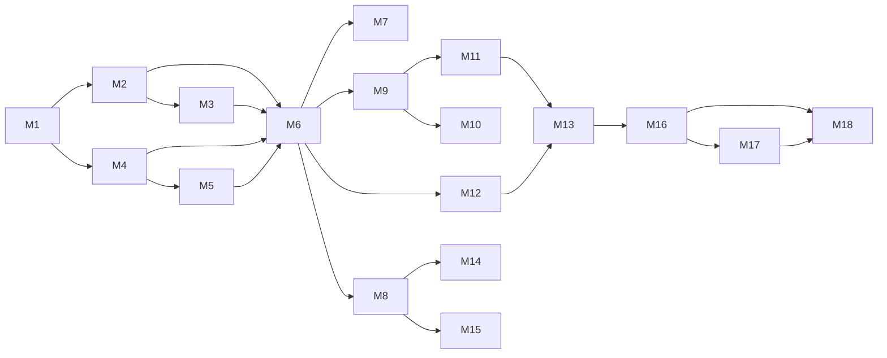

# 13 — Agent Execution Playbook

How an autonomous coding agent (or a human following the same protocol) turns this blueprint into the running system. This file is PROCESS ONLY: every functional contract lives in the numbered docs and wins over anything restated here. When this file and a spec doc disagree, the spec doc is authoritative — fix this file.

## Reading order

Before writing any code, read in this order:

1. `docs/00-overview.md` — goals, non-goals (scope fence).
2. `docs/01-architecture.md` — locked stack, repository layout, layering rules.
3. `docs/02-data-model.md` — every table, enum, convention, invariant.
4. The milestone's own section in `docs/10-roadmap.md` plus EVERY doc it references (map below) — before starting that milestone, not all upfront.

| Milestone | Primary specs to read first |
| --- | --- |
| M1 | docs/01, docs/02 |
| M2 | docs/03 |
| M3 | docs/04 (+ docs/02 rules/learned_payees) |
| M4 | docs/05, docs/07 |
| M5 | docs/06 (+ docs/02 acb_pools invariant) |
| M6 | docs/09 (+ docs/08 shapes for every route wired) |
| M7 | docs/11 |
| M8 | docs/12 |
| M9 | docs/14 |
| M10 | docs/09 (+ docs/10 §M10) |
| M11 | docs/05, docs/07 |
| M12 | docs/08, docs/09 |
| M13 | docs/08, docs/09 |
| M14 | docs/12 |
| M15 | docs/12 |
| M16 | docs/07 (+ docs/02 fundamentals) |
| M17 | docs/07 (+ docs/02 etf_holdings, docs/05) |
| M18 | docs/05 |

## Milestone dependency graph

Declared dependencies (docs/10), drawn transitively reduced:



M8's declared deps on M2–M5 are subsumed by M6 above (M6 cannot complete without them). Parallel waves:

- **W1:** M1
- **W2:** M2 ∥ M4
- **W3:** M3 ∥ M5
- **W4:** M6
- **W5:** M7 ∥ M8
- **W6:** M9 ∥ M12
- **W7:** M10 ∥ M11 ∥ M14 ∥ M15
- **W8:** M13
- **W9:** M16
- **W10:** M17
- **W11:** M18

A milestone starts only when every dependency has passed its full definition of done (docs/10 intro) — not merely "code exists".

## Per-milestone protocol

1. Read the milestone's specs per the table above.
2. Implement exactly what they specify. The blueprint invents nothing at execution time: filenames, error codes, formulas, response shapes, and conventions are already pinned — follow them.
3. Run the milestone's smoke test against REAL running services (`docker-compose up`, real Postgres) — a green test suite alone never satisfies acceptance.
4. Gate on the definition of done (docs/10 intro): `alembic upgrade head` clean on a fresh DB, `ruff check` + `ruff format --check` clean, `pytest` green against real Postgres, smoke test executed, and (web changes from M1 onward) `tsc --noEmit` + `vite build` green, and the owning spec doc(s) reconciled with the implementation per AGENTS.md §9.
5. Record any deviation or ambiguity resolution in the work summary; then, and only then, advance.

## Live-probe evidence cache (per commit)

AGENTS §4 step 5 verifies a change against the **running** stack with the probes in `frontend/scripts/a11y/`. Each probe costs minutes (Chrome + a seeded throwaway tenant), and a rebase changes nothing that is deployed — yet every rebase re-ran 3–6 full probe suites against the identical build. Run the battery through `scripts/run_probes.py`, which looks the evidence up FIRST; invoking a probe directly still works and always runs (no cache).

```bash
python3 scripts/run_probes.py --list                 # cost before paying it: hit / miss per probe
python3 scripts/run_probes.py                        # default suite `live` — needs PROBE_ALLOW_PROD=1 (production default base, see below)
python3 scripts/run_probes.py shell-visual           # the shell visual-regression matrix only (docs/47 §18)
python3 scripts/run_probes.py 'm12*_probe.py' --arg width=390 --arg out=/tmp/report.json
python3 scripts/run_probes.py --refresh              # ignore the cache and overwrite it
python3 scripts/probe_cache.py ls [--commit SHA]     # what is stored, and whether it is still fresh
```

### Production targets need the flag (t_498845bf)

The runner and every seeding probe refuse a **production** base —
`fintrac.princessandmark.com`, internal hosts such as example.internal `192.0.2.109:8080`,
and the `127.0.0.1:18080` smoke tunnel — unless `PROBE_ALLOW_PROD=1` is in the
environment. Pointed at production by default, ~250 throwaway tenants created
with repo-public passwords piled into the production database; they were
purged 2026-11-09 under an explicit GO, and the guard is what keeps them from
regrowing. Loopback bases (`http://127.0.0.1:<port>`, including the local
compose `:8080`) never need the flag; `--list` is exempt; the flag is
inherited by every probe the runner launches; the runner exits 2 before
touching anything when the gate refuses.

```bash
PROBE_ALLOW_PROD=1 python3 scripts/run_probes.py            # deliberate production battery
python3 scripts/run_probes.py --base http://127.0.0.1:5173   # local stack, no flag
python3 backend/scripts/purge_probe_tenants.py               # backstop sweep: dry run + ROLLBACK by default
python3 backend/scripts/purge_probe_tenants.py --apply       # purge (guarded COMMIT)
```

Probe passwords are **per-run secrets** (`probe_target.random_password()`):
no password literal lives in a tracked probe file, and probes keep passwords
out of evidence JSON (`strip_passwords()` at the dump sites — the committed
evidence files were scrubbed to `<redacted-password>`, card t_32cd7b8e).

The sweep derives its DELETE order from the live `pg_constraint` graph and
refuses to COMMIT unless candidates = 0, the user total moved by exactly the
candidate count and the demo tenant is untouched — see the module docstring.

Cache contract (full rationale in `scripts/probe_cache.py`):

- **Key = the deployed stack + the probe's identity, never the working tree.** Deploy host `git rev-parse HEAD` (the per-commit label) plus the web/api container image ids, the sha256 of the SERVED `/sw.js`, and — for the probe — its own bytes, `a11y_driver.py`, the axe-core manifest, the base URL and the forwarded args. A rebase, or a `git pull` that does not rebuild, therefore **hits** (the entry is filed under the old commit's directory and the hit says so); any rebuild **misses** and re-runs.
- **The deploy host is a runtime value, never a repo literal.** The ssh target that reads the stack identity comes from `PROBE_DEPLOY_SSH` (default `example.internal`, a non-resolving placeholder the operator overrides at run time) — the same rule as `scripts/smoke.sh`'s `SMOKE_SSH_HOST` (default `example.internal`), whose steps 8-9 self-skip without it.
- **Nothing is stored or served unless the identity is complete** (deploy host reachable and `/sw.js` fetchable) **and the run passed** (`exit 0`). Failures always re-run — a failure is the thing that must be re-measured — and an unknown build can never produce a verdict.
- **Freshness has two rules**: recorded TODAY (host-local date: every probe asserts date-relative facts — day-change windows, seeded dates) and younger than `--max-age-hours` (default 12).
- **A hit keeps the evidence honest.** The report JSON is restored to its `--out` path when the file is missing (fresh worktree), verified by hash when it is present, and NEVER overwritten when it belongs to a different run — the cached copy stays in `~/.cache/fintrack-probe-evidence/commits/<commit>/` (`PROBE_EVIDENCE_DIR` overrides). Every hit prints the commit, trust verdict and timestamp it came from.
- **Probes run serially** (the shared CDP driver pins one debug port and one Chrome profile) and a probe that takes neither `--base` nor `A11Y_BASE`/`SITE_BASE` is SKIPPED with a printed reason: it cannot be aimed at the deployed build, so it must not be reported as verified against it.
- **Screenshots are not cached.** Every real run still writes its PNGs next to the probe script; only the JSON report and the verdict ride the cache. `--out` moves the JSON only.
- A deploy checkout that is NEWER than both containers (the pull-without-rebuild gap) is printed as `checkout-ahead`: the commit stays a label and the image ids are what is actually running.

## Probe de-risking standard (M148)

A probe drives a **live** deployment that the owner is using: the same uvicorn
worker, the same 15-connection pool, the same Postgres. The 2026-10-11 outage
(docs/01 § "Sessions and the event loop") landed inside a window where probe
traffic was running against production, so the standard exists to make it
impossible for a probe to be the thing that takes the stack down — and to make
a sick stack visible before a probe is blamed for it.

Every probe (and the runner that launches them) must:

1. **Check `/api/v1/health` first.** `scripts/run_probes.py` does this before
   it launches anything and refuses to run against an unhealthy stack
   (`--skip-health-check` is the deliberate override). A probe that starts
   without this check is measuring a stack that may already be failing.
2. **Log latencies, not just verdicts.** A rising `/health` or route latency is
   the first symptom of pool exhaustion — the API answers, then answers slowly,
   then stops answering. Record the timings in the evidence JSON so a later
   reader can see the trend, and abort the run when a bound is crossed rather
   than letting a probe hammer a degrading stack for another ten minutes.
3. **Never fan out.** The API runs ONE uvicorn worker with a 15-connection
   pool (docs/01). Browser parallelism plus a seeding burst can fill it, and a
   filled pool is an outage, not a slow test. Seed through the API in small
   serial batches; cap any client-side concurrency at a handful of requests;
   never replay a route N times in parallel "to save time".
4. **Seed its own throwaway tenant**, never the demo tenant, and clean up —
   the shared demo is what every visitor sees.

The M146 probe detected this outage rather than causing it, which is exactly
what a probe should do when a stack is already sick: report it, do not pile on.

## Guardrails

Invariants an executor must never break:

- **The event loop never waits on the database** (docs/01 § "Sessions and the event loop"): `get_db` stays a sync generator dependency, and any `async def` that touches the DB hops through `run_in_threadpool`. One blocked loop is a whole-API outage (M148).
- **Locked stack** (docs/01): no library/framework substitutions.
- **Money is Decimal end-to-end** (docs/01, docs/02) — floats never touch amounts, quantities, or rates.
- **`acb_pools` single write path** through `backend/app/tax/acb.py` rebuilds inside the caller's transaction (docs/02 invariant).
- **Manual data wins**: manual prices/prices rows over yfinance backfill; manual fx fills gaps only, never overwrites BoC rows (docs/07).
- **Network egress enumerated: exactly `services/fx.py` (BoC Valet), `services/market_data.py` (yfinance) and `llm/base.py` (the single LLM seam), plus `mcp_server/` HTTP to `FIN_TRACKER_URL` only** (AGENTS.md §2; full inventory docs/11 "What leaves the machine"); report endpoints never fetch (docs/12); privacy-mode blocks wrap all three data seams (docs/11).
- **Staging rule**: batch-scoped reads filter on `import_batches.status='committed'`; dedup UNIQUE spans pending + committed (docs/03).
- **Tenancy**: `user_id` on every domain table and query except the shared `fx_rates` cache (docs/02).
- **No scope invention**: no extra features, dependencies, tables, or endpoints beyond the spec docs; milestones are never renumbered or merged.
- **Clean cutover**: when a change invalidates existing code/docs, migrate every callsite and update affected docs in the same change, and create a new `docs/NN` spec (per AGENTS.md §9) for any behavior that has no spec doc.

## Ambiguity handling

Resolve in this precedence: (1) the most specific spec doc covering the case → (2) docs/02 contracts (enums, conventions, invariants) → (3) the most conservative option consistent with existing conventions. If levels 1–3 genuinely conflict, STOP and surface the conflict with both readings instead of guessing; never silently pick one and move on.

## Backend suite on the deploy box (example.internal)

`cd ~/fin_tracker/backend && .venv/bin/pytest …` on example.internal answers `bash: .venv/bin/pytest: cannot execute: required file not found`. The checkout there can carry a `.venv` that is a **build artifact of the `api` image**, not a dev environment: root-owned, `uv 0.12.18` / CPython 3.12.14 with `home = /usr/local/bin`, every script in `bin/` shebanged `#!/src/.venv/bin/python` (the image's `/src`, which does not exist on the host) and `bin/python` dangling at `/usr/local/bin/python3.12`. Its 2026-09-23 mtime and those paths say the image's own tooling ran against a bind-mounted checkout once; the Dockerfile `COPY`s its sources, so a plain `docker compose build` never writes it — and nothing ever removes it.

Repair (one-time per checkout, verified 2026-10-12):

```bash
cd ~/fin_tracker/backend
# Root-owned leftovers cannot be deleted by the `developer` user (sudo needs a password),
# so go through docker, where `--user 0:0` is available. The api image's own USER is
# `appuser`, which gets Permission denied — the flag is the point.
docker run --rm --user 0:0 --entrypoint rm -v "$PWD":/mnt/backend fin_tracker-api:latest \
  -rf /mnt/backend/.venv /mnt/backend/.pytest_cache
~/.local/bin/uv sync           # uv lives at ~/.local/bin, which the non-login PATH of
                               # `ssh example.internal '<cmd>'` does NOT include — a bare `uv run`
                               # there answers "command not found"
set -a && . ../.env && set +a  # app/core/config.py reads `.env` from the CWD, and the
                               # deployed credentials live in the REPO ROOT's .env —
                               # `cd backend` alone falls back to conftest's dev default
                               # and dies with "password authentication failed for user
                               # \"fintrack\"" (a red that looks like a broken venv)
.venv/bin/pytest -q
```

- `python3 -m venv` is NOT an alternative on that box: only 3.13 is installed and `ensurepip` is absent, so the venv is created without pip. `uv sync` is the documented tool and it installs the pinned `uv.lock` set plus the `dev` group (pytest/ruff) in one step.
- `.venv/` and `.pytest_cache/` are gitignored, so this is a checkout-local repair — nothing of it is committed or shipped. Root-owned `__pycache__` dirs left by the same build only cost a re-compile per import (Python skips the write it cannot do); the `.pytest_cache` is the one that surfaces as `PytestCacheWarning: cache could not write path …`.
- Proved on the repaired venv: `tests/test_m148_pool_deadlock.py` → `4 passed in 7.30s`. The `reaped database left by a dead run:` lines conftest prints are its normal reaping of dead runs' databases, not an error.
- This makes the suite *runnable* on example.internal; it does not make a full run fast there. A bare `pytest -q` on the host still stalls on the market-data sockets, because the router's `fc.yahoo.com` null-route is container-scoped, not host-wide (fin-tracker playbook, "Full suite vs the Yahoo stall").

## Test isolation contract (M178)

Three waves went red with the same class, each fixed one leak at a time — which is
why it kept coming back: a test opens **an engine of its own** (a live server, a
`TestClient` lifespan seed, `get_engine()`) and COMMITS rows that the `session`
fixture's outer transaction can never roll back, and a later test reads that table
**without a tenant filter**. `t_17d025b2` (a lifetime-seeded demo tenant → 20
failures in five later modules), `t_a451f171` (a live server's registration → a
foreign "groceries" that made `test_ynab_migration` red on 2 of ~8 full runs and
never solo) and `t_70d46e5e` (the same leak seen from the read side).

`backend/tests/conftest.py` now states the contract and enforces both sides, so a
file's verdict no longer depends on which module happened to run first:

**R1 — nothing a module commits may outlive the module.**
`_guard_module_left_no_tenant_state` (module scope, autouse) snapshots a row count
per tenant table at module start and fails at module end when any table differs,
naming the module and the table. `_guard_no_committed_tenant_survives` (session
scope) is the backstop and compares the same footprint against the session-start
one. Both are footprint checks, not emptiness checks: the decoy below and any
migration-seeded row are part of the baseline, so they are not residue. A module
may hold committed rows **across its own tests** (m149, m155 and the auth-hardening
races do, on purpose) as long as its teardown takes them away again.

**R2 — the suite database is deliberately dirty.**
`_decoy_tenant` commits a foreign tenant — a `users` row plus the 10
`DEFAULT_CATEGORIES` that `POST /auth/register` writes, i.e. exactly the residue
the incidents left — before the first test and removes it after the last. An
unscoped read therefore resolves to the wrong answer on EVERY run instead of on
the runs where a leak happened to land first; that is what makes "passes alone" and
"passes in the suite" the same measurement. `ISOLATION_DECOY_TENANT=0` disables it
for a bisect of a scoping failure (and never in a release run).

Consequences for a test author:

- **Scope every read by `user_id`.** A helper that looked up a row by name
  (`category_by_name`) is now `MultipleResultsFound` the moment the database
  carries a second tenant — which it always does. For a table with no `user_id`
  of its own (`transaction_tags`, `rule_tags`, `bill_reminder_match_terms`) scope
  through the parent's ids.
- **Delete the whole tenant in the fixture that made it** — `DELETE /users/me`
  runs docs/20's cascade, or delete by `user_id` on a connection of your own.
  Templates: `tests/test_m149_offloop_routes.py::tenant`,
  `tests/test_m155_price_session.py::tenant_fixture`.
- **Opting back into lifespan seeding still requires the hermetic own-DB module
  fixture** listed in `conftest._SWAP_MODULES` (above); the guards are a net, not
  a licence.
- **Boundary:** the footprint watches the principal `users` table, every table
  with a `user_id` column (derived from `app.models`, 44 of them) and the three
  tenancy-inheriting child tables — 48 in all. Operator-level caches (`fx_rates`, `benchmark_prices`,
  `provider_fund_registry`) are shared facts, not tenant data — `provider_registry`
  has its own per-test rollback fixture.

`tests/test_tenant_scoping_contract.py` pins all of it: the derivation covers every
tenanted model, the decoy is really committed, an unscoped category read is
ambiguous on purpose, and the module guard FAILS a child session that leaks a
tenant (with a clean-session control so "fails a leak" cannot mean "fails
everything").

## Verification command reference

| Concern | Command |
| --- | --- |
| Backend suite on example.internal | The checkout's `.venv` may be an api-image build artifact (root-owned, shebanged `/src/.venv/bin/python`) and `uv` is off-PATH — repair and run per **"Backend suite on the deploy box"** above before believing any local example.internal verdict. |
| Migrations | `alembic upgrade head` (idempotent on fresh DB) |
| Backend lint/format | `ruff check` / `ruff format --check` (rules `E F I UP B S RUF`; bandit's `S` set included — see docs/01 §Tooling for the per-file/inline ignores) |
| Backend tests | `pytest` (against compose Postgres — never SQLite). Runs parallel with coverage reporting via `addopts` (`-n auto --dist loadfile`, `--cov=app --cov=mcp_server`) — a targeted single-file run inherits both; pass `-n0 --no-cov` for a serial run with no coverage, which is also required for any hand-rolled child pytest run that pins `TEST_DB_ID` |
| Frontend types/lint/build | `tsc --noEmit` · `eslint .` · `vite build` |
| Full stack | `docker-compose up` → exercise the milestone's smoke test from docs/10 |
| Live-probe battery | `python3 scripts/run_probes.py --list` → `python3 scripts/run_probes.py` (per-commit evidence cache — see "Live-probe evidence cache" above) |
| Deployed web identity | `curl -s https://<host>/ | grep -o 'build-commit" content="[^"]*"'` → the commit the LIVE web image was built from (meta tag stamped by `frontend/scripts/stamp-build.mjs`). A `-dirty` suffix means the deploy host's checkout carried uncommitted edits, so the served bytes are NOT that commit — re-deploy from a clean tree before trusting any figure. The stamp carries no timestamp, so rebuilding a commit stays byte-identical. |
| Deployed-engine run (QA acceptance) | For money-math acceptance, execute the RUNNING container's own engine read-only instead of re-deriving figures in SQL: `ssh example.internal 'docker exec -i fin_tracker-api-1 python' < probe.py`, where the probe is `from app.api.deps import get_engine` + `from sqlmodel import Session` + `from app.services import <module>`. Two traps this avoids: (1) there is no `app.core.database` — the engine is `app.api.deps.get_engine()`; (2) use **`sqlmodel.Session`**, not `sqlalchemy.orm.Session` — service fns call `.execute` (SQLAlchemy) one layer down and `.exec` (SQLModel) deeper, and only the subclass satisfies both. Commits nothing, needs no tokens, and runs the exact code that serves prod. Recipe re-proved read-only 2026-10-10 (`investment_cash_cad` on the demo tenant's first account → 877.41); the same pattern served qabot's M132 acceptance (the account's `investment_cash_cad` → 0.27, matching the deployed header). |
